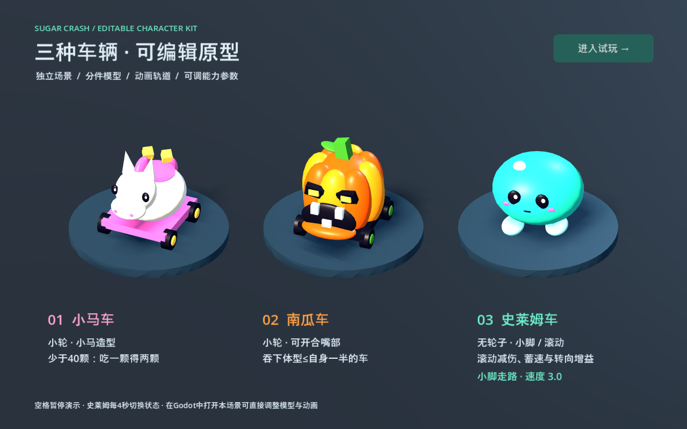

# 不给糖就撞 原型

文档版本：V0.3 · 2026-11-01 · 三车原型已接入。

本工程是 Godot 4.4.1 验证过的 3D 俯视单机原型。1 名玩家与 3 个 AI 进行 180 秒糖果争夺；现已加入小马车、南瓜车、史莱姆车的可编辑模型、基础动画、专属能力和状态提示。模型与声音仍用于原型验证。



文档入口：[车辆使用与程序交接](docs/vehicles.md) · [美术、动画、UI 与音效制作要求](docs/art-production.md)。本 README 记录当前代码行为，制作要求另列尚待完善的正式素材。

## 启动

- 本机双击 `play.cmd` 开始游戏，双击 `edit.cmd` 打开编辑器。这两个入口使用本机已安装的 `E:\jam game\godot\Godot_v4.4.1-stable_win64.exe`，不存在时自动尝试 console 版本。
- 也可以在 Godot 中导入本目录的 `project.godot`，按 F5 运行。
- 换电脑时用 Godot 4.4 或更新版本打开 `project.godot`；本项目未使用外部插件或下载依赖。

操作：WASD / 方向键 / 手柄左摇杆移动；松开减速；Esc 暂停或继续；R 重新开始。地面圈标出玩家。试玩 HUD 显示糖果、质量、尺寸、速度、排名和剩余时间。

## 三种车辆原型

- 按 **1 / 2 / 3**，或点击底部按钮，选择小马 / 南瓜 / 史莱姆。切换会开始新一局，R 重开保留选择。
- 按 **F2** 进入或退出能力试验：AI 静止、时间不减少；小马从 38 颗开始并有一排糖，南瓜从 80 颗开始面对 20 颗的目标，史莱姆可沿空地直行观察收脚滚动。R 重置试验。
- 双击 **vehicles.cmd** 查看三车动画展示，也可以在 Godot 打开 `scenes/vehicle_showcase.tscn` 按 F6。空格暂停演示，右上角进入正常试玩。
- 角色参数：`config/vehicles/pony.tres`、`pumpkin.tres`、`slime.tres`。完整交接说明见 [docs/vehicles.md](docs/vehicles.md)。

| 角色 | 已实现能力 |
|---|---|
| 小马车 | 少于 40 颗时每颗拾取获得 2；逐颗跨阈值结算，自己掉落的糖不翻倍。39 吃 1 得到 41，20 吃 12 得到 42 |
| 南瓜车 | 车头左右各 60° 内接触体型不超过自己一半的车时吞噬，直接转移其全部糖果；不再重复爆糖或结算普通碰撞，目标 3 秒后重生 |
| 史莱姆车 | 速度小于 4 用小脚走，大于 4 收脚滚动；恰好 4 保持上一状态。滚动时普通车撞伤害乘 0.7 后取整、直行蓄速贡献乘 1.5、每转 90° 保留 92.5% 速度 |

史莱姆的最高速度仍为 9，滚动不免除撞墙 5% 损失或南瓜吞噬。南瓜沿用 2.2 倍体型上限，因此 80 颗可吞 20 颗；达到体型上限后最多吞 24 颗的目标。模型装饰和动画形变不影响大小判定。

## 项目架构

```text
project.godot
scenes/
  match.tscn             主场景：比赛流程、4 辆实例化车辆、相机、HUD
  arena.tscn             编辑器里摆好的场地、固定墙、16 个糖箱和出生点
  car.tscn               玩家与 AI 共用的车辆节点结构
  ai_car.tscn            保留的通用 AI 车辆场景；三车对局直接覆盖各实例的 Driver
  solid_wall.tscn        不可破坏墙体
  candy_obstacle.tscn    可撞碎糖箱，独立模型/碰撞体/爆糖位置/粒子
  candy.tscn             糖果外观、拾取区域和合并数量标签
  hud.tscn               可编辑的调试界面、暂停和结算面板
scripts/
  match.gd               对局、重生、中立糖果、最终排名
  car.gd                 车辆运动、糖果状态、质量与尺寸
  drive_input.gd         输入控制接口
  player_driver.gd       玩家输入
  ai_driver.gd           拾取、外圈蓄速、择机撞箱、躲避、南瓜择机追逐可吞目标
  collision_math.gd      不依赖场景的数值公式
  collision_resolver.gd  撞前快照、接触去重、双方扣糖和障碍结算
  candy_system.gd        糖果生成、容量控制、批次生命周期
  candy.gd               抛出、弹跳、拾取保护、消失和拾取动画
  car_feedback.gd        车辆形变、纸屑、尾迹和音效
  camera_rig.gd          可关闭的撞击震动
  hud.gd                 界面显示与按钮事件
  game_tuning.gd         Inspector 参数定义
config/prototype.tres    当前测试参数
assets/                  图标和场地网格材质
tests/                   数值、实际物理、控制和整局自动测试
scenes/vehicles/         三个车辆继承场景与三个独立外观场景
scenes/vehicle_showcase.tscn  可直接运行的三车动画展示
config/vehicles/         三个角色的只读参数资源
scripts/vehicle_profile.gd   能力参数与拾取阈值计算
scripts/vehicle_visual.gd    小轮、小脚、滚动与动画控制
docs/vehicles.md         三车美术、动画与程序交接说明
docs/art-production.md   已实现状态与后续美术、动画、UI、音效清单
```

```text
Car (CharacterBody3D)
├── BodyCollision
├── GrowthRoot                   成长尺寸
│   └── HitPivot                 撞击挤压
│       ├── Model                通用测试外观；三个角色中隐藏
│       └── CharacterVisual      三个独立外观场景之一
│           ├── Motion           车身、轮心/小脚、下颚或 RollRoot
│           ├── Sockets          MouthSocket / PickupSocket / TrailSocket
│           └── AnimationPlayer  实际拾取或吞噬动画轨道
├── PlayerRing
├── NameLabel
├── Driver                       玩家 / AI 控制器
├── AnimationPlayer              基础场景预留；角色关键帧在 CharacterVisual 内
└── Feedback
    ├── PaperParticles
    ├── SpeedTrail
    ├── Sound
    ├── MovementSound
    └── Gain                     拾取数字
```

固定地图、车辆、界面、碰撞形状和表现节点均保存在 `.tscn`。运行时会实例化动态糖果，并在开局时按选择装载完整的车辆场景；不会用代码逐个拼装角色的模型节点。没有全局单例，重新开始重载本局状态；当前进程中的车辆选择和能力试验开关会保留，退出游戏后恢复默认。

车辆采用 `CharacterBody3D` 的扫掠碰撞检测；统一结算器按质量计算街机式反弹和伤害，以精确实现撞墙减速 5% 与撞碎后继续前进。它不是真实轮胎/悬挂模拟。物理根节点不做成长缩放，独立调整每辆车自己的碰撞形状，模型在 `GrowthRoot` 上平滑缩放。

## 已采用的规则

| 项目 | 当前值 |
|---|---|
| 初始糖果 | 20 |
| 基础 / 最高速度 | 3 / 9 |
| 蓄速 | 实际主动行驶距离驱动，系数 L=18；转向、顶墙、被推不计蓄速；滚动史莱姆新增有效距离按 1.5 倍计入 |
| 转向 | 普通状态累计转 90° 保留 85% 速度，滚动史莱姆保留 92.5%；明显转向期间暂停提速 |
| 质量 | `0.5 + 0.025 × 糖果数` |
| 尺寸 | `clamp(sqrt(糖果数 / 20), 0.5, 2.2)`，倍率指车身线性尺寸 |
| 车对车伤害 | 相对接近速度、约化质量和双方主动冲撞能力；系数 k=1 |
| 单次伤害上限 | 仅以现有糖果数为限；已取消 35% 上限，可一撞清空 |
| 撞墙 | 速度保留 95%；掉落 `floor(糖果数 × 5%)` |
| 糖箱 | 正面冲击能量 `0.5 × 质量 × 法线速度² ≥ 22.5` 撞碎；只产糖一次 |
| 糖箱奖励 | 12；成功撞碎时仍扣自身 5% 糖果和速度，但不反弹 |
| 连续接触 | 分离后才重新允许伤害；同一对接触还需间隔 0.5 秒 |
| 散落糖果 | 正常对局中 8 秒消失，原主人前 0.5 秒不能捡；其他车可抢；能力试验预摆糖延长寿命 |
| 爆糖表现 | 按损失比例区分三档；主方向 70%，其余随机；落地弹跳、拾取飞入 |
| 数量上限 | 最多 240 个糖果节点；合并时保留总价值与各批次保护/寿命 |
| 重生 | 3 秒后寻找空闲出生点；恢复 20 颗，清除速度、蓄速、接触和旧形变 |
| 比赛结束 | 完成本物理帧后固定成绩，同糖数量并列获胜 |

30 颗、速度 6 正面撞糖箱可以破坏。按普通拾取、暂不收回自己的掉糖计算，连续撞箱为 `30 → 41 → 51 → 61`；小马首箱会触发翻倍，30 颗撞箱后扣到 29，再拾取 12 颗可达到 47。无技能减伤或吞噬时，两辆初始车中，A 以速度 9 撞静止 B，A 掉 4 颗、B 掉 20 颗；两车满速正面对撞可同时出局。

## 在编辑器中修改

基础参数在 `config/prototype.tres`，角色参数在 `config/vehicles/*.tres`。选择资源，在 Inspector 中修改相应字段。资源只存配置，当前糖果、速度和滚动状态存在每辆车自己的实例中。

- 改布局：打开 `scenes/arena.tscn`，移动或复制 `SolidWalls` / `CandyObstacles` 下的场景实例。
- 改初始位置：调整 `scenes/match.tscn` 中 `Vehicles` 下实例的位置。重生位置独立存放在 `arena.tscn` 的 `VehicleSpawnPoints`。
- 改出生点和中立糖位置：移动对应 Marker3D。移动地图边界时还需同步 `ai_driver.gd` 的外圈路径与 `candy.gd` 的场内限制；本原型按固定 40×28 场地制作。
- 替换三车素材：分别打开 `scenes/vehicles/pony_visual.tscn`、`pumpkin_visual.tscn`、`slime_visual.tscn`，替换其中网格，保留动画引用的节点和枢轴，或同步调整路径。模型前方朝 -Z、底部贴 y=0。成长、撞击、碰撞体和 Driver 继续由共用车辆管理。
- 三车的 `paint_mesh_paths` 当前为空，保留角色材质；若需要自动染色，再指向实际网格路径。隐藏的 `Model` 是通用测试车辆外观，不是三个角色的素材替换入口。
- 替换障碍素材：修改各障碍场景的 `VisualRoot`，并调整 `BodyCollision`。墙体是灰色固定物，糖箱是金色礼盒占位素材。
- 爆糖位置预留 `CandySpawn` Marker3D；实际逻辑使用该位置的平面坐标，飞行高度由三档散射参数控制。
- 关闭镜头震动：选择主场景的 `CameraRig`，取消 `shake_enabled`。

## 验证

在 PowerShell 中，先将 `$godotExe` 设为你实际的 Godot 程序路径，再运行：

```powershell
$godotExe = 'E:/jam game/godot/Godot_v4.4.1-stable_win64_console.exe'
& $godotExe --headless --path . --import
& $godotExe --headless --path . --script res://tests/test_runner.gd
& $godotExe --headless --path . --fixed-fps 60 --script res://tests/vehicles.gd
& $godotExe --headless --path . --fixed-fps 60 --script res://tests/driving.gd
& $godotExe --headless --path . --fixed-fps 60 --script res://tests/soak.gd
```

测试失败返回非零退出码。整局测试将 180 秒模拟时间加速运行；实际游戏仍使用正常时间。正式素材、联网、复杂导航和完整无文字教学不在这版原型内。

2026-11-01 三车实现交付时的验证记录：基础测试 55 项、角色测试 56 项，共 111 项通过；实际驾驶/转向测试通过；180 秒完整对局模拟正常结束；三车展示与实际对局已做 Godot 图形预览检查。此次文档更新未修改运行代码。

## 提交与推送

本仓库当前使用 `main` 分支，`origin` 配置为 `https://github.com/kzayabc01-byte/collision-game.git`。在 PowerShell 中依次执行：

```powershell
Set-Location 'C:\Users\Kzay\Desktop\suger'
git status --short
git add README.md docs config scenes scripts tests vehicles.cmd
git diff --cached --stat
git commit -m "feat: add three vehicle prototypes and update docs"
git push origin main
```

命令提交三车实现与文档；`.godot/` 导入缓存由 `.gitignore` 排除，脚本的 `.uid` 文件随脚本一起提交。若 Git 提示没有可提交的变化，可跳过 commit，继续 push。
