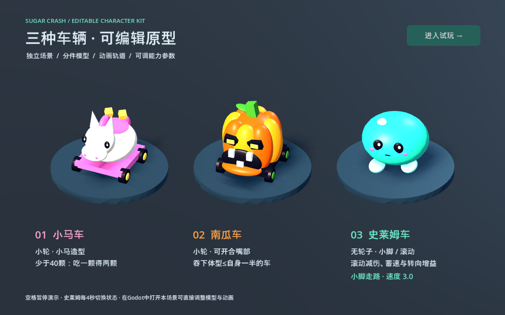

# 《不给糖就撞》美术、动画、UI 与音效制作需求

版本：V0.3 · 2026-11-01  
用途：三人内容制作分工与程序接入依据。三种车辆的能力、可编辑分件模型、基础动画与状态提示已经接入原型。第 3 节记录当前实现；第 4～8 节列出正式素材的制作目标，其中未完成项按下表安排。标注“建议”的美术预算、风格与后续调参事项仍属于建议。

配套说明：[启动与操作](../README.md)、[车辆节点与代码交接](vehicles.md)。本版替代 V0.2。



| 部分 | 已实现 | 后续工作 |
|---|---|---|
| 三种车 | 小马/南瓜四个小轮；史莱姆无轮、两个小脚；各自独立外观场景 | 正式模型、材质、贴图、表情与轮廓调整 |
| 角色能力 | 小马阈值翻倍、南瓜车头吞噬、史莱姆滚动增益 | 试玩调参，不重新实现同一套能力 |
| 动画 | 小轮转动、小马拾取点头、南瓜张嘴/吞入、史莱姆收脚/滚动、共用受撞与成长 | 鬃尾、侧倾、胶体形变、精细出局/重生等表现 |
| UI | 角色切换、角色名称、技能状态、糖果增量、F2 能力试验 | 正式角色头像、能力图标、可吞目标标记与界面美化 |
| 声音 | 程序合成的拾取、撞击、吞咽、小脚步伐和滚动切换短音 | 正式采样、行驶/滚动循环、材质区分、混音 |
| 墙体 | 不可破坏灰墙、可破坏礼盒占位场景与爆糖结算 | 正式两类皮肤、碎片模型、破碎动画与材质音 |

原型入口：`play.cmd` 试玩，1/2/3 切换角色，F2 进入能力试验，R 重置；`vehicles.cmd` 展示三车动画。

## 1. 制作目标与分工

项目为 3D 俯视车辆碰撞游戏。主要表现链路为：行驶蓄速 → 碰撞 → 爆糖 → 拾取 → 体型变化。角色差异需要从实际游戏镜头中看清，技能收益也要有对应反馈。

建议统一为“万圣节糖果玩具”风格：圆润体块、清楚轮廓、少量大色块，场地较暗，车辆和糖果较亮。危险感通过张嘴、挤压、破碎表达，保持轻松卡通气质。

| 负责人 | 负责范围 | 交付结果 |
|---|---|---|
| 美术资产 | 三种车辆、墙体皮肤、糖果、场地材质、角色表情与特效贴图 | 可编辑源文件、导出模型/贴图、分件和枢轴说明 |
| UI 与音效 | 界面布局、图标、提示、界面动效、声音制作和接入 | UI 场景、图标源文件、分类声音、触发与音量说明 |
| 动画与特效 | 车辆动作、形变、技能表现、爆糖运动、障碍破碎和镜头反馈 | 可编辑 Godot 场景、动画、粒子效果、参数与事件清单 |
| 程序整合 | 技能规则、状态切换、碰撞判定、数值同步和验证 | 稳定的事件和状态接口，使表现与结算一致 |

界面内的动效归 UI；场景内的车辆、糖果、障碍和镜头反馈归动画负责人。美术负责提供效果需要的形状、碎片和贴图，动画负责人负责让它们运动。

## 2. 已确定的角色要求

| 角色 | 外观约束 | 用户确定的能力 |
|---|---|---|
| 小马车 | 小马主题；轮子较小 | 糖果少于 40 时，吃一颗获得两颗 |
| 南瓜车 | 南瓜主题；轮子较小 | 可以直接吞吃目标线性尺寸不超过自身 50% 的车；这个比例已经确认 |
| 史莱姆车 | 没有轮子；有可收起的小脚 | 速度低于 4 时走路，高于 4 时滚动；滚动时防御增加 30%、速度积累效率增加 50%、转弯减速幅度减半 |

当前“转弯减速幅度减半”以每 90° 损失从 15% 降至 7.5% 实现。

两类障碍保留现有性质：不可破坏墙、撞击达到条件后爆糖的可破坏障碍。每一类都可以替换多种外观，材质名称不直接决定功能。

## 3. 当前已经实现的能力规则

### 3.1 小马车：按每一颗糖结算

每消费一颗实际糖果前检查当前持糖数，少于 40 就获得 2，否则获得 1。当前合并糖果使用等价分段公式结算，避免合并显示改变技能收益。

| 拾取前 | 实际拾取颗数 | 实际结果 |
|---|---:|---:|
| 38 | 1 | 40 |
| 39 | 1 | 41 |
| 39 | 3 | 43 |
| 40 | 3 | 43 |
| 20 | 12 | 42 |

自己掉落的糖果再拾回时不翻倍；中立糖、障碍产糖和其他车辆掉落的糖可翻倍。掉落批次保留来源，避免利用撞墙与回收反复制造糖果。合并批次按加入顺序结算，分别保留拾取保护和到期时间。

技能增量属于额外收益：吃一颗时移除一颗场景糖果，额外的那颗只通过计分和短暂图形表现，不生成可拾取实体。后续跌回 40 以下，技能自然重新生效。

### 3.2 南瓜车：车头接触、半尺寸吞噬与糖果转移

按统一的游戏体型倍率判定：`目标 size_scale <= 南瓜 size_scale × 0.5`。三种角色使用相同基准碰撞尺度；耳朵、藤蔓、小脚和瞬时挤压形变不参与大小判定。判定不读取每帧动画的包围盒。

当前触发方式：前方与合格目标发生有效接触时自动吞噬，侧面和背面接触按普通碰撞处理。程序按碰撞前朝向和接触方向判断车头左右各 60° 范围，模型嘴部用于表现。无需主动技能按键。

当前结算：吞噬成功时，目标当前糖果全部转给南瓜，目标 3 秒后寻找安全位置重生。被吞目标不再额外爆出一份糖，该次接触也不再重复进行普通撞击扣糖与反弹。目标外观约 0.28 秒缩入嘴部，结算只执行一次，使用接触发生前的体型快照。

沿用当前原型体型公式 `clamp(sqrt(糖果 / 20), 0.5, 2.2)` 时：

| 南瓜糖果 | 目标糖果 | 体型关系 | 是否达到比例 |
|---:|---:|---|---|
| 20 | 5 | 1.0 对 0.5 | 是 |
| 80 | 20 | 2.0 对 1.0 | 是 |
| 80 | 30 | 2.0 对约 1.225 | 否 |
| 100 及以上 | 24 | 2.2 对约 1.095 | 是 |
| 100 及以上 | 25 | 2.2 对约 1.118 | 否 |

因此，当前上限下，即使南瓜继续增加糖果，也只能吞到最多 24 颗糖的目标。这是现有体型上限带来的结果；本制作单暂时沿用上限，后续试玩再决定是否调整。

当前有符合条件的目标接近前方时，南瓜小幅张嘴提示；完整张合嘴动画在实际吞噬成功时播放。正式嘴部亮光与目标身上的独立标记仍待制作，不加入远距离吸附。

### 3.3 史莱姆：将三项增益变成明确数值

当前实现口径：

| 项目 | 走路状态 | 滚动状态 |
|---|---|---|
| 状态条件 | 速度 < 4 | 速度 > 4 |
| 速度恰好为 4 | 保持上一状态；初始为走路 | 保持上一状态 |
| 车对车受伤 | 普通伤害 | 本次应扣糖果乘 0.70，再统一取整 |
| 主动直行距离的蓄速贡献 | 1.0 倍 | 1.5 倍 |
| 转向 90° 后的速度保留 | 85% | 92.5% |
| 最高速度 | 沿用原型的 9 | 沿用原型的 9 |

转向按累计角度计算，滚动时为 `0.925 ^ (转向角度 / 90°)`，避免结果依赖每秒帧数。这里“减半”以每 90° 的损失从 15% 降到 7.5% 定义。

蓄速增益通过每次新增有效行驶距离乘 1.5 实现；已有积累值保持连续，切换状态不立即跳速。被推、贴墙和明显转向仍沿用原型的蓄速限制。

防御增益只减免普通车辆碰撞造成的掉糖，不改变撞墙掉 5% 的规则，不降低击退，也不抵消符合条件的南瓜吞噬。减伤采用碰撞前的滚动状态，在整数取整前应用。

逻辑在跨过速度 4 时切换；小脚收起、主体形状和状态圈采用指数平滑过渡，可调整外观场景的 `transition_speed`。当前使用脚步和状态转换短音；正式连续滚动声的混合仍待音效制作。

## 4. 三种车辆的美术与动画需求

### 4.1 小马车

**造型建议**：做成小马外形的玩具车，突出马头、短鬃毛、尾巴和圆润车身。奶油白搭配浅粉或淡蓝，少量糖果色点缀。技能提示用糖果图案与成对亮点，保证从俯视角也能看到。

**轮子**：四个小轮，建议轮径约为车身长度的 18%～22%。以当前约 1.8 的基础车长为参考，轮径约 0.32～0.40。轮轴独立，轮缘略露出车身，能够看清转动并接触地面。

**需要的分件**：车身、头部、鬃毛、尾巴、四个轮子、表情面、技能提示面或标记点。小马耳朵与尾巴为装饰，不改变碰撞范围。

| 动画/效果 | 表现要求 |
|---|---|
| 待机 | 车身轻微呼吸或点头，幅度小 |
| 行驶 | 轮速随实际位移变化；鬃毛和尾巴轻摆 |
| 转向 | 轻微侧倾，停止转向后迅速恢复 |
| 普通拾取 | 轻点头或短暂亮眼 |
| 双倍拾取 | 糖果进入车身后出现成对亮点；玩家短暂看到“+2” |
| 技能达到 40 后关闭 | 糖果标记熄灭或降低亮度；数值同步 |
| 受撞 | 沿受力方向挤压并回弹，轮子保持附着 |
| 出局/重生 | 使用共用主体效果，保留小马表情变化 |

双倍拾取动作不控制实际行驶，不需要每吃一颗都完整播放长动作。连续吃糖时合并轻量反馈，避免画面与音效堆叠。

### 4.2 南瓜车

**造型建议**：橙色分瓣南瓜作为主体，短绿色藤柄，大嘴位于车头并延伸到上前方，让当前俯视镜头能看见开口。嘴里有暖色微光，车头轮廓和吞噬方向明确。

**轮子**：同样采用四个小轮，轮径约车身长度的 18%～22%。底盘与轮子保持简洁，南瓜主体占主要视觉面积。

**需要的分件**：南瓜壳、下颚或可开合嘴部、口腔内侧、牙齿、藤柄、四个轮子、眼睛或表情层。口腔要有封闭内壁，张嘴时不能露出场景背景。前方提供 `MouthSocket` 接入点。

| 动画/效果 | 表现要求 |
|---|---|
| 待机 | 藤柄轻摆，眼睛或内部微光缓慢变化 |
| 行驶/转向 | 小轮转动，主体有克制的惯性倾斜 |
| 可吞噬提示 | 符合比例且进入前方提示区时，嘴部微亮或小幅张开 |
| 吞噬 | 张嘴 → 目标外观缩入嘴部 → 合嘴 → 短暂鼓胀后恢复 |
| 吞噬成功 | 糖果增长数字和短光点；按实际获得数量显示 |
| 无法吞噬的接触 | 使用普通碰撞反馈，不播放吞噬成功效果 |
| 受撞/出局/重生 | 共用流程，加南瓜外壳摇动与表情 |

建议吞噬整段约 0.25～0.40 秒。目标缩入嘴里的对象是展示用外观；真实目标在结算后立即失去本次参与碰撞和拾取的资格，避免动画中继续撞车或吃糖。禁止在动画结束回调里再次发放糖果。

### 4.3 史莱姆车

**造型建议**：软糯圆团，蓝绿或紫色果冻质感，大眼睛，两个短小脚；没有轮子、轮轴或轮胎纹路。初版建议用不透明主体配高光与边缘效果表达胶体感，便于多只角色和糖果重叠时保持轮廓清晰。

**需要的分件**：主体、眼睛/嘴、左右脚、可独立滚动的视觉层；可用少量骨骼或形态键完成压扁、拉长和收脚。低速时脚要能在当前游戏镜头里看见，高速时彻底收起。

| 动画/效果 | 表现要求 |
|---|---|
| 待机 | 缓慢挤压回弹，眼睛小幅运动 |
| 小脚走路 | 左右脚交替，主体重心微微起伏；步频随实际位移变化 |
| 走路转滚动 | 压低主体 → 收脚 → 变圆 → 接续滚动 |
| 滚动循环 | 绕局部横轴连续滚动，按路程与有效半径计算滚动角 |
| 滚动转走路 | 减慢滚动 → 恢复可读朝向 → 伸脚落地；根节点不瞬移 |
| 滚动防御提示 | 体表紧实的高光边缘或短弧线，配简洁状态图标 |
| 受撞 | 胶体明显挤压回弹；滚动时更紧实，但仍能看出受击 |
| 拾取 | 糖果进入体内的短亮点，避免长期堆积实体糖果 |
| 出局/重生 | 短暂摊开或软化后淡出；重生从小团恢复 |

行驶朝向、成长缩放和滚动旋转分成不同节点，不能让模型滚动同时把运动控制轴翻转。脚不挂在持续翻滚的节点下面；收起后隐藏，退出滚动再恢复。表情分件保留独立调整空间，确保关键帧能辨认角色。

## 5. 两类墙体与可替换外观

功能分为 `solid` 和 `candy_breakable` 两类。模型与材质通过场景里的视觉子节点替换，碰撞、产糖和去重规则由功能组件负责。

| 功能 | 建议首发外观 | 后续可复用外观 | 必须传达的信息 |
|---|---|---|---|
| 不可破坏 | 厚实石墙、圆角石柱 | 铁护栏、加固木墙 | 厚重、稳定，碰撞后仍完整 |
| 可撞碎爆糖 | 糖果木箱、包糖纸礼盒 | 糖罐、脆饼障碍 | 内有糖果、有可破开的接缝，成功撞击会解体 |

每类初版先完成一种外观即可，功能和反馈通过后再扩充材质与皮肤。

**不可破坏墙需要准备**：直段、角段或端盖、柱体；完整模型；受击灰尘/火花接入点。不会因为几次碰撞逐步变成永久裂纹，也不播放摧毁效果。

**可破坏障碍需要准备**：完整模型、约 4～8 块展示碎片、可选空壳残留、糖果喷出点 `CandySpawn`。碎片不形成新的阻挡物，短时间后淡出。

两类都要有三种可读反馈：轻擦、正面碰撞、强撞；可破坏类额外有成功破碎。未达到破坏条件时，只做短暂形变或闪烁，不能留下暗示“累计受伤”的永久裂纹，因为当前原型按单次撞击能量判定。

现有原型参考值：破坏能量阈值 22.5，奖励 12 颗；30 颗糖、速度 6 的正面撞击可破坏。撞墙后速度为原来的 95%，掉落当前糖果的 5% 并向下取整。破坏成功时继续向前，失败时反弹。持续贴墙不重复触发扣糖、闪光和撞击音。

材质可以替换，功能识别必须保留：不可破坏类使用厚实边框或铆钉；可破坏类带糖果标记、包装接缝或可见糖果。避免仅依赖颜色区分两类。

## 6. 共用美术、动画和特效

### 6.1 糖果

最小交付为 1 个清晰的糖果模型；有余量再做圆糖、包纸糖、条糖三种外观，初版价值一致。每种可共用材质图集，避免复杂透明包装。

糖果表现要覆盖：生成抛出、空中自转、落地弹跳、静置、拾取飞入、临近到期提示、到期消失。实际飞行距离由程序计算，动画负责曲线、旋转、拖尾和节奏。

沿用原型的三档散射，车长参考值为 1.8：

| 档位 | 散射距离 | 首次腾空时间 | 视觉重点 |
|---|---|---|---|
| 轻 | 0.4～0.8 个基础车长 | 0.25～0.40 秒 | 近距离、低弧线、短拖尾 |
| 中 | 0.8～1.5 个基础车长 | 0.40～0.60 秒 | 扇形抛出、清楚弹跳 |
| 重/出局 | 1.5～2.5 个基础车长 | 0.60～0.90 秒 | 更远、更高、短促爆发 |

主方向约占 70%，其余向周围散开。普通车对车掉糖按既有损失比例选择档位；墙体掉糖使用轻档，糖箱破碎按冲击能量选中档或重档。三种角色共享糖果散射系统。

逻辑掉糖量决定价值；展示数量过多时允许合并，但不得丢失总价值、来源、拾取保护和剩余寿命。小马技能的来源判定也需要这些信息。

### 6.2 共用效果清单

| 效果 | 制作要求 |
|---|---|
| 速度反馈 | 随实际速度逐步增强的尾迹；低速很弱，满速明显 |
| 轻/中/重撞击 | 共用基础形变，按力度调整幅度、粒子和音色 |
| 体型增长/缩小 | 约 0.15～0.25 秒平滑过渡，逻辑质量与碰撞体及时同步 |
| 糖果拾取 | 轨迹短、目标明确，不让飞入效果遮挡下一次碰撞 |
| 出局 | 一次明显的掉糖爆发和外观退场，防止重复播放 |
| 重生 | 从小到大恢复或短淡入，接入现有重生事件 |
| 玩家识别 | 地面标记、编号或名称，不依赖角色种类与主体颜色 |
| 镜头反馈 | 主要响应玩家相关撞击，强度有上限，可关闭 |

装饰碎片、光点、速度线与真实可拾取糖果采用不同轮廓，避免玩家追逐不能拾取的特效。

## 7. UI 需要准备什么

基础界面继续使用现有糖果、速度、排名、时间、暂停和结算。新增内容只服务三种已定义能力。

| 项目 | 状态/内容 |
|---|---|
| 三种角色头像 | 小马、南瓜、史莱姆；排行榜和玩家状态共用 |
| 小马能力图标 | 低于 40 时亮起“×2”，达到阈值后变暗；必要时提示“不含自己掉落的糖” |
| 南瓜能力图标 | 嘴部图形；提示吞噬成功与实际糖果收入 |
| 可吞目标提示 | 只对符合条件的目标显示简洁标记；不改变目标碰撞判定 |
| 史莱姆状态图标 | 小脚/滚动两态；滚动态显示防御与蓄速增益的简短说明 |
| 糖果增减数字 | 普通拾取、双倍拾取、受伤、吞噬收入能够区分 |
| 三种能力说明 | 可放在原型说明面板，帮助测试者理解；不强制新增角色选择流程 |

尺寸建议：源图保留矢量或可编辑分层文件；头像导出 256×256，状态图标导出 128×128，实际显示时缩小检查。图标既有轮廓差异也有明暗差异，颜色作为辅助信息。

## 8. 音效需要准备什么

所有时长、变体数量和格式均为初版制作建议。优先做可辨认、不过载的反馈，再增加细节。

| 分组 | 声音 | 触发与建议 |
|---|---|---|
| 小马 | 行驶循环 | 轻玩具车滚动感；随速度平滑变化 |
| 小马 | 双倍拾取 | 共用拾取声增加第二个短音；0.08～0.20 秒 |
| 南瓜 | 行驶循环 | 较低、略空心的滚动声，与小马区别 |
| 南瓜 | 张嘴/吞咽 | 短开口声与有分量的卡通吞咽；成功时才播放成功音 |
| 史莱姆 | 小脚步伐 | 2～3 个软糯短音交替；按步伐事件播放 |
| 史莱姆 | 收脚起滚/伸脚落地 | 各 1 个短过渡音；阈值抖动时不反复叠加 |
| 史莱姆 | 滚动循环 | 胶体摩擦和呼呼声；由实际速度驱动 |
| 史莱姆 | 滚动受击 | 更紧实的弹性声，区别于普通受击 |
| 共用 | 糖果拾取 | 2～3 个轻短变体，可连续听 |
| 共用 | 轻/中/重车辆碰撞 | 至少 3 档；各档可有 2 个变体 |
| 共用 | 爆糖和落地 | 爆发 1 组、落地短音 2～3 个；合并播放 |
| 墙体 | 不可破坏墙撞击 | 首版按石材准备；未来皮肤可切换金属/木材音色 |
| 障碍 | 未破坏的碰撞 | 短促受击，不带成功碎裂和奖励音 |
| 障碍 | 成功破碎 | 破壳与糖果散落可分层，整体不拖长 |
| 流程 | 出局/重生 | 各 1 组，短而明确 |
| UI | 确认/返回或暂停 | 各 1 个轻提示 |
| 流程 | 结束/结果 | 结束提示与结果短音；音乐可后补 |

建议交付 48 kHz WAV 源文件，无削波；场景短音优先单声道，UI 与音乐可按需要立体声。循环素材标注无缝循环点，不在开头保留长静音。文件名注明角色、事件、力度与变体。

混音建议：玩家受击、吞噬和出局优先；远处 AI 声音衰减。糖果落地按时间窗口合并，不能几十颗糖同时各播一个完整音效。角色行驶声平滑交叉淡入淡出，不在每帧重新播放。

## 9. 交付格式与 Godot 接入

### 9.1 文件要求

建议提交：模型可编辑源文件（如 `.blend`）与 `.glb`；贴图 `.png` 及分层源文件；Godot 场景 `.tscn`、动画与材质资源；声音 `.wav` 及必要的工程源文件。可复用公共资源只保留一份。

建议初版每辆车控制在约 2,000～6,000 个三角面，主体贴图 1024×1024，材质槽约 1～3 个。该范围是便于快速制作的预算建议，不是已测得的性能上限。小轮优先保证轮廓，避免把面数用于俯视镜头看不见的内部结构。

模型前方朝 `-Z`，上方为 `+Y`，落地点为 `y=0`，根节点应用缩放。以糖果 20 时的约 1.8 基础车长制作。三种角色主车身统一基准尺度和碰撞尺度，造型差异主要通过轮廓、分件和材质实现。各轮枢轴在轮心；南瓜下颚枢轴在铰接处；史莱姆滚动枢轴位于主体中心。

### 9.2 当前实际场景结构

各角色的车辆继承场景和独立外观场景已经保存在 `scenes/vehicles/`，主要节点可直接在编辑器中修改：

```text
Car                         # 现有运动与状态根节点
├── BodyCollision           # 逻辑体型更新；不跟随表演挤压
├── GrowthRoot              # 仅负责成长缩放
│   └── HitPivot             # 仅负责碰撞形变
│       └── CharacterVisual # pony / pumpkin / slime 独立场景
│           ├── Motion
│           │   ├── Body / Head / RollRoot  # 按角色使用
│           │   ├── WheelFL等 / FootL和FootR
│           │   └── Jaw / Face             # 按角色使用
│           ├── Sockets
│           │   ├── PickupSocket
│           │   ├── MouthSocket   # 南瓜使用
│           │   └── TrailSocket
│           └── AnimationPlayer
├── Driver
└── Feedback                # 共用粒子与声音入口
```

能力由 `config/vehicles/*.tres`、共用车辆与统一碰撞结算器实现，当前没有独立的 Ability 节点。成长、撞击和糖果系统继续共用。`MouthSocket` 已用于吞噬；`PickupSocket` 和 `TrailSocket` 当前为预留标记。

正式素材进入工程时，建议在 `assets/` 下按 `vehicles/pony`、`vehicles/pumpkin`、`vehicles/slime`、`obstacles`、`candy`、`ui`、`audio` 分类。现有几何网格与材质直接保存在各外观场景中，尚未交付外部模型源文件或正式音频采样。

### 9.3 程序与表现的交接事件

| 事件/状态 | 表现需要的数据 |
|---|---|
| 移动更新 | 实际速度、行驶方向、实际位移、是否有主动输入 |
| 角色状态改变 | 走路/滚动、能力是否生效 |
| 拾取糖果 | 实际消耗颗数、最终增加糖果数、是否触发翻倍 |
| 发生撞击 | 受力方向、撞击力度、实际掉糖、障碍类型 |
| 发生吞噬 | 目标外观引用、吞噬位置、实际所得糖果 |
| 成长变化 | 旧尺度、目标尺度；表现不自行推算判定大小 |
| 出局/重生 | 对象、位置、原因；保证一次事件只播一次 |

这些数据由共用车辆、碰撞结算器与场景协调逻辑提供；表现通过信号或明确调用获得结算结果。声音、粒子与 UI 不根据“画面看着像碰到了”自行发奖励或重复扣糖。

## 10. 推荐制作顺序

1. 三人先运行 `vehicles.cmd` 与 F2 能力试验，核对当前节点、动作和技能结果。
2. 美术按已有枢轴和角色尺度制作正式三车分件模型，以及一套不可破坏墙、一种可破坏糖箱。
3. 动画负责人沿用已接通的事件与动作入口，完善鬃尾、侧倾、胶体形变、吞噬和破碎效果。
4. UI 与音效负责人替换正式头像、状态图标、声音与混音，保持阈值和实际增量提示一致。
5. 用实机“移动 → 撞箱 → 爆糖 → 拾取 → 成长 → 撞车”流程验收，并复查三种技能临界值。
6. 通过后再做第二套墙体皮肤、更多糖果外观和声音变体。

## 11. 验收清单

- 在实际俯视镜头、最小 0.5 倍及最大 2.2 倍体型下，都能辨认三种车；小马和南瓜的小轮能接地，史莱姆没有轮子。
- 同糖果数量时，角色的装饰差异不改变判定尺度；受击挤压、张嘴、滚动都不改变吞噬资格。
- 小马在 38、39、40 颗糖附近的单颗与批量拾取结果正确；表现显示实际增量，拾回自己掉落的糖不能翻倍。
- 南瓜在“正好一半”和“略大于一半”两侧判定正确；吞噬只结算一次，未吞噬不播放成功音，目标糖果不会同时转移和掉落。
- 史莱姆在速度 4 两侧连续过渡；小脚没有在滚动中露出，滚动不改变实际行驶方向。防御和蓄速提示与真实状态一致。
- 墙体换皮后仍能分辨性质；撞不碎时没有永久裂纹或奖励声，撞碎后碎片不阻路。
- 弱、中、强撞击的糖果散射和音画反馈可区分；连续贴墙不重复播放完整撞击效果。
- 大量糖果、多个角色同时出现时，能看清自己、可拾取糖果和障碍；高频声音有并发限制。
- `.tscn` 中可直接替换模型、粒子和声音，并能预览关键动画；交付包含可编辑源文件和资源路径说明。

## 12. 已落实事项与后续调参

**已经落实**：统一逻辑体型尺度；合并糖果分段检查小马阈值；小马自身掉糖不翻倍；逻辑结算与吞噬动画分离；UI 与声音显示真实结果；主体、轮子、嘴和脚可独立编辑。基础与角色测试共 111 项通过，完整对局模拟和图形预览完成。

**建议试玩后再判断**：南瓜体型上限是否限制了后期体验；吞噬前方接触区的角度；史莱姆的减伤是否过强；小马的双倍提示是否过于频繁；墙体与糖果是否需要更多外观。

**本轮制作范围**：围绕已经实现的三种能力和现有碰撞循环完善素材与反馈；1/2/3 选择、F2 能力试验和三车展示用于开发验证，不属于新增战斗技能。
