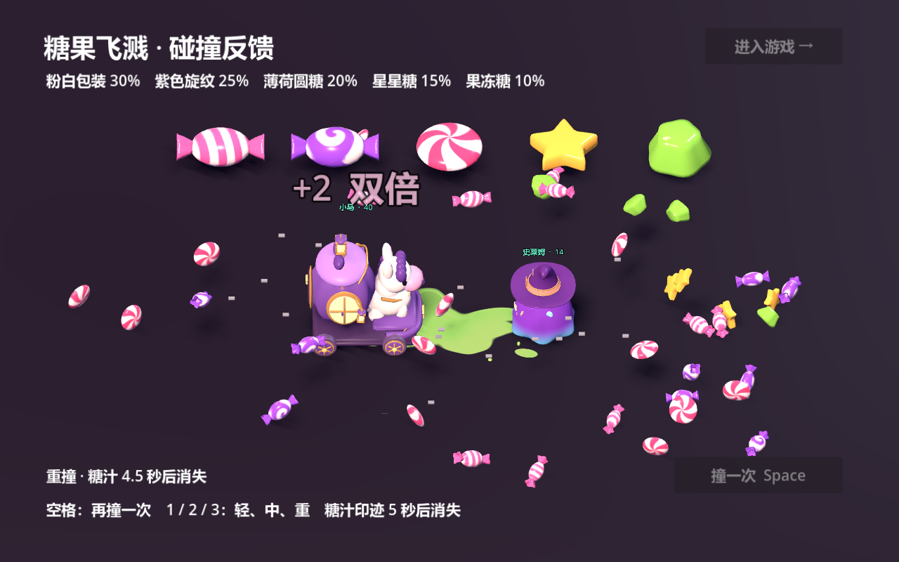

# 糖果外观、碰撞反馈与糖汁

已接入正式 `match.tscn`。`play.cmd` 进入游戏；`impact.cmd` 打开近景演示，空格重放，1 / 2 / 3 切换轻、中、重撞。演示固定两车位置，方便看糖果、形变和糖汁；正式对局保留实际反弹和击退。



## 五种外观

| 外观 | 概率 | 单个默认价值 |
| --- | --- | --- |
| 粉白条纹包装糖 | 30% | 1 |
| 紫白螺旋包装糖 | 25% | 1 |
| 红白旋纹圆糖 | 20% | 1 |
| 黄色星星糖 | 15% | 1 |
| 绿色果冻糖 | 10% | 1 |

在每个掉落物生成时抽一次外观，随后不变；尺寸只随机 ±10%。所有款式仍用半径 0.35 的同一种拾取形状。合并显示继续显示数量标记，保存各批糖果的所有者、保护期和到期时间，外观不参与价值或角色收益计算。

模型源文件为 `art_source/candies.blend`，五个独立根节点可直接在 Blender 修改。纹理打包在 `.blend` 和 GLB 中。导出位于 `assets/models/candies/`；款式及权重集中在 `config/candy_visuals.tres`。`art_source/build_candies.py` 只是离线重建工具，游戏运行不调用 Blender。

每款约 476—3008 个三角面。一个糖果节点只实例化被选中的一个 GLB；不会同时挂五个模型。

## 碰撞表现

表现强弱主要取碰撞计算已有的能量和迎面相对速度。`config/impact.tres` 中能量 6 为中撞门槛、18 为重撞门槛；中撞能量下若损失过半可提升为重撞表现。相对速度低于 0.3 或能量低于 0.15 不生成飞溅。

- 车身沿主要受力轴压缩约 12% / 18.5% / 25%，随后在 0.34 秒内弹回，碰撞体不随形变改变。
- 接触点显示约 0.12 秒星芒和短弧线。镜头沿撞击方向短促偏移，只响应玩家参与的碰撞。
- 玩家重撞暂停运动约 0.065 秒，击溃约 0.09 秒，连续顿挫最短间隔 0.25 秒。AI 单独互撞不触发顿挫或震屏。
- 顿挫时车身碰撞体仍注册在物理世界；暂停/恢复、重开、返回菜单不会修改全局时间倍率。碰撞音允许在短暂顿挫期间继续输出。
- 小马头、尾和灯笼，南瓜下颚、藤蔓和灯笼有滞后摆动；拾糖和吞噬主动画优先。史莱姆沿受力方向压缩、回弹，原滚动和收帽动画继续工作。
- 重撞糖果主体初次落地时间约 0.35—0.55 秒，25% 高抛约 0.6—0.75 秒。糖果空中翻转、最多弹两次，果冻落地压扁回弹。原散射距离、所有权保护和数量规则继续生效。

本次不调整伤害公式、质量/体型、墙体扣糖比例、糖箱收益或反弹冲量。表现用的能量分档与伤害计算分开维护。

## 糖汁

每次有效新接触生成一次地面糖汁与短促液滴，持续贴墙不会每帧生成。小马粉色、南瓜橙黄、史莱姆黄绿色；车对车使用损失更多一方的颜色。糖汁沿碰撞方向延伸，重撞覆盖更大、液滴更快更多。吞噬沿用专用动画。

印迹前 4 秒保持，最后 1 秒淡出，到第 5 秒释放整个特效节点。暂停时计时停止；正常顿挫期间液滴和印迹继续播放。最多同时存在 80 个特效，超过时跳过新的纯视觉特效，不影响碰撞结算。

使用透明平面 shader，兼容项目当前的 Compatibility 渲染器。它适用于当前平地竞技场；若之后加入坡道或台阶，需要按落点地表高度和法线放置。糖汁没有碰撞或滑行效果。

## 编辑入口

| 文件/节点 | 修改内容 |
| --- | --- |
| `art_source/candies.blend` | 五种模型、糖纸纹理、材质 |
| `config/candy_visuals.tres` | 随机权重、大小变化范围、GLB 引用 |
| `scenes/candy.tscn` | 拾取范围、数量标签、外观挂点 |
| `config/impact.tres` | 表现门槛、顿挫、糖汁寿命与数量上限 |
| `scenes/effects/sugar_impact.tscn` | Stain / Flash / Droplets 三个独立可编辑节点 |
| `assets/shaders/syrup_stain.gdshader` | 糖汁轮廓、边缘和湿润感 |
| `assets/shaders/impact_flash.gdshader` | 接触星芒和弧线 |
| `scenes/car.tscn` → Feedback | Sound 拾糖音、ImpactSound 车体声、CrackSound 糖壳声 |
| `assets/audio/impact/*.wav` | 三款车体碰撞和糖壳碎裂声，可直接换成正式音效 |
| 三车 `*_visual.tscn` 的 `impact_paths` | 附件受击摆动节点 |
| `scenes/match.tscn` → ImpactEffects | 正式对局的临时特效容器 |

音效是本地合成的原型素材，木质、空腔和弹性质感分别给三种车使用；`art_source/build_impact_audio.py` 可离线重建。碰撞与拾糖使用不同播放器，拾糖不再截断碰撞音。

## 验证

Godot 4.7.2 验证：随机权重、外观固定与合并价值、拾取范围、受力方向形变、糖汁 4 秒保持/第 5 秒清除、音效并播、顿挫碰撞体保留、AI 不震屏、暂停恢复、退出时全局时间正常。保留原车辆、驾驶、菜单流程、防穿墙及碰撞结算回归测试；另跑完整 180 秒对局模拟。

```powershell
# 逻辑检查（无窗口模式不验证音频设备输出）
Godot --headless --path . --max-fps 60 --script res://tests/impact_feedback.gd
# 真实音频混音检查：不要加 --headless 或 --audio-driver Dummy
Godot --path . --max-fps 60 --script res://tests/impact_feedback.gd
Godot --headless --path . --fixed-fps 60 --script res://tests/test_runner.gd
Godot --headless --path . --fixed-fps 60 --script res://tests/soak.gd
```

`capture_impact.gd` 录制近景并检查 5 秒后特效节点已清除；`capture_match_impact.gd` 截取正式竞技场画面。声音检查读取实际混音样本，不只判断播放器是否处于 playing 状态。
