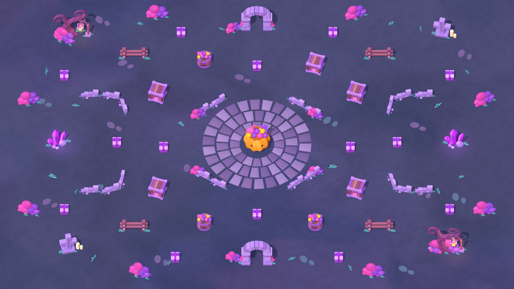

# 参考图地图布局

2026-11-11。使用项目中从 GitHub 更新的 `assets/models/reference_sheet_01/` GLB，以及原有紫色礼盒。没有使用上一轮已经取消的模型。



## 打开

- `play.cmd`：原来的片头、开始界面、选车、正式对局流程。
- `map.cmd`：只看完整地图，无车辆和 HUD，方便对照布局。
- Godot 中打开 `scenes/maps/arena/arena.tscn`：直接移动、旋转、替换地图节点。
- `arena_overview.tscn` 是全景查看场景；正式对局仍使用原来的玩家跟随镜头。

## 场景与位置

可玩范围仍为 X=-40～40、Z=-28～28，即 80×56。地面碰撞为 82×0.4×58，装饰地面为 124×98。Z 负方向对应图中上方。

| 节点 | 布置与用途 |
|---|---|
| `CenterPlaza` | 中央三圈石砖，每一块均是独立节点；仅铺地，没有碰撞 |
| `SolidWalls/OuterCurves` | 四角各一组弧形矮墙，每组由三段下载的矮墙拼成 |
| `SolidWalls/InnerDiagonals` | 圆台外围四组斜向矮墙，每组两段 |
| `SolidWalls/Fence*` | 左上、右上、左下、右下四处木围栏 |
| `Landmarks` | 上下拱门、左右水晶、对角枯树与墓碑、灯笼和局部光源 |
| `CandyObstacles` | 14 个原礼盒、5 个木箱、3 个木桶、1 个中央南瓜糖桶 |
| `Scenery` | 灌木、青绿杂草和踏石，不阻挡车辆 |
| `VehicleSpawnPoints` | 原四个出生点；左右备用复活点移至水晶旁的空地 |
| `CandySpawnPoints` | 中央刷新点避开南瓜桶，防止糖果生成在障碍内部 |

整个布局是保存好的 `.tscn` 场景，运行游戏时不靠脚本创建地图节点。下载的 GLB 保持原文件不变。地面使用 `reference_ground.tres`，延续原蓝紫地面图案并接收阴影。

## 障碍规则

木箱、木桶、南瓜桶共用现有 `scripts/obstacle.gd`、`collision_resolver.gd` 和 `config/prototype.tres`；中央大南瓜单独配置 100 颗奖励：

- 撞击能量至少 22.5 才碎；30 颗糖、迎面速度 6 正好达到门槛。
- 中央大南瓜撞碎奖励 **100 颗**，在 `arena.tscn` 的 `CandyObstacles/CenterPumpkin` 节点上设置 `reward_override = 100`。礼盒、木箱、木桶仍为 12 颗；装在模型里的糖球只是外观，不额外结算。
- 同次撞击仍扣自身糖果的 5%，向下取整，速度保留 95%。例如 30 颗、速度 6 撞碎中央大南瓜：车辆剩 29 颗、速度 5.7，地面生成 100+1=101 颗；撞碎普通容器则为 12+1=13 颗。
- 同一障碍只结算一次；碎后隐藏模型、关闭碰撞，现有碎片、爆糖和糖汁反馈继续生效。
- 矮墙、围栏、树干、墓碑、水晶与拱门柱不可破坏；拱门两柱分开设置碰撞，中间允许车辆通过。

23 个容器总静态奖励为 364 颗（22×12+100），不含车辆自身碰撞掉落的糖果。

## 后续怎么改

独立障碍场景在 `scenes/maps/arena/props/reference/`。打开对应 `.tscn`，修改 `VisualRoot/Model` 的显示尺寸，同时修改 `BodyCollision.shape.size` 和中心高度。不要缩放物理根节点来改变长宽高。

移动单个物体：在 `arena.tscn` 中选择对应实例，调整 Transform。修改同类所有物体：打开对应独立障碍场景。编辑拱门柱：展开 `Landmarks/ArchNorth` 或 `ArchSouth`。

边界保留原有四个物理墙体与镜头边界读取路径，隐藏原来的矩形墙模型，参考图外围装饰覆盖边缘。旧的教堂、糖屋和布景源文件仍保留，但本布局不再实例化。

## 验证

Godot 4.7.2：地图与实际碰撞 165 项、原核心行为 55 项、跟随镜头 158 项、UI 进出流程 62 项通过。地图检查涵盖最大体型的六个出生点、AI 绕行路线、拱门实际通车，以及三种新容器的撞碎、奖励和重复碰撞。

最后一次完整 180 秒 AI 对局：250 次障碍/车辆撞击反馈、76 次车车接触、4 个容器被撞碎，车辆全程留在可玩范围。以上是使用固定初始种子的原型检查，不代表已经完成长期平衡测试。

```powershell
Godot --headless --path . --script res://tests/reference_arena.gd
Godot --headless --path . --script res://tests/test_runner.gd
Godot --headless --path . --script res://tests/follow_camera.gd
Godot --headless --path . --script res://tests/ui_flow.gd
Godot --headless --path . --fixed-fps 60 --script res://tests/ai_soak.gd
```
