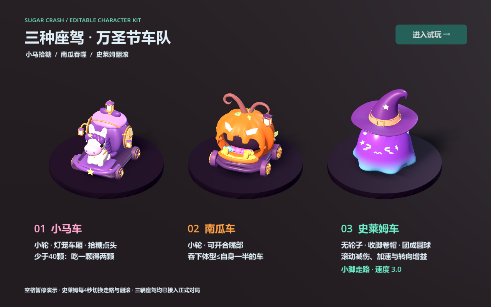

# 三车 Blender 模型与动画交接

2026-11-09。Blender 4.5.4 LTS；Godot 4.7.2 Compatibility。

三辆车均已接入选车和正式对局。双击 `vehicles.cmd` 查看三车同屏展示，史莱姆每四秒切换走路/翻滚，空格暂停。双击 `pumpkin.cmd` 可交互演示南瓜吞车；双击 `play.cmd` 正常进入游戏。已经打开的旧游戏窗口需要关闭后重新启动。



## 交付内容

| 车型 | 外观和动画 | Blender 分件对象 | 导出对象 / 三角形 |
|---|---|---:|---:|
| 小马 | 象牙白小马、紫色车厢、窗框、灯笼、鬃尾、四个小轮；拾糖点头与灯笼摆动、行驶尾摆 | 146 | 26 / 63,672 |
| 南瓜 | 分瓣壳体、口腔、下颚、小轮、藤蔓灯笼；开嘴吞车、咬合回弹 | 100 | 18 / 56,332 |
| 史莱姆 | 紫蓝渐变胶体、表情、星星、巫师帽、两只小脚，无轮子；收帽团球翻滚、回正展开 | 30 | 12 / 33,432 |

这是参考图方向的第一版可编辑模型，尚未做到参考图中的手绘质感。当前材质以基础色、粗糙度和发光为主；史莱姆使用不透明的渐变高光 shader，并非真正折射的透明胶体。Godot 导入开启自动 LOD，尚未针对低端设备专门优化，也未验证手机端性能。

## 文件分工

| 文件 | 负责内容 |
|---|---|
| `art_source/pony.blend`、`pumpkin.blend`、`slime.blend` | 美术主源文件，细节零件可独立修改，附独立摄影棚 |
| `assets/models/<车型>/<车型>.glb` | 游戏用模型，静止部件适度合并，运动部件保留 |
| `assets/models/<车型>/<车型>_animations.tres` | Godot 外部动画库，可在 AnimationPlayer 编辑关键帧 |
| `scenes/vehicles/<车型>_visual.tscn` | 持久化包装场景，引用 GLB、动画库、挂点与视觉脚本 |
| `scripts/pony_visual.gd` | 在共用动画接口上增加尾摆和双倍标记路径 |
| `scripts/slime_visual.gd` | 接收移动速度/体型，协调变形、翻滚、小脚、回正 |
| `assets/shaders/slime_glaze.gdshader` | 胶体渐变和边缘高光 |
| `assets/models/slime/slime_glaze.tres` | 胶体颜色、粗糙度与高光参数 |
| `config/selection/*.tres` | 选车模型、比例、位置和朝向 |
| `scenes/vehicle_showcase.tscn` | 三车展示的灯光、镜头、台座和文字 |

游戏不会执行 Blender 建模脚本，不会每次运行重新拼装模型。`art_source/.gdignore` 排除摄影棚与 Blender 工程自动导入。GLB 内嵌材质，没有外部贴图依赖。

史莱姆的程序网格没有完整 UV，当前 shader 不依赖 UV 或法线贴图，导入设置关闭了 `meshes/ensure_tangents`。后续制作手绘贴图/法线贴图时，先在 Blender 展开 UV，再启用切线生成。

## 关键节点

```text
小马 CharacterVisual
├─ Motion/Model/PonyArt
│  ├─ Coach、Head、Tail、Bow、BonusMarker
│  ├─ LanternL、LanternR、RoofLantern
│  └─ WheelFL、WheelFR、WheelBL、WheelBR
├─ Sockets
└─ AnimationPlayer → pony_animations.tres

史莱姆 CharacterVisual
├─ Motion/Model/SlimeArt
│  ├─ RollRoot
│  │  ├─ JellyBody（Round 形态键）
│  │  ├─ Face
│  │  └─ Hat
│  └─ FootL、FootR
├─ DefenseRing、Sockets
├─ AnimationPlayer → pickup、RESET
└─ MorphPlayer → roll_pose
```

GLB 中自带的原始 AnimationPlayer 仅供查看；运行时由包装场景的播放器驱动外部动画库。不要同时播放两套动画。包装场景已启用可编辑子节点，可调整材质覆盖；改几何形状应回 Blender。

## 动作约定

小马 `pickup` 约 0.38 秒：点头、回弹、灯笼滞后摆动。四个轮子按速度和体型转动。小轮半径为 0.1677 游戏单位，修改网格尺寸时同步包装场景的 `wheel_radius`。

史莱姆速度大于 4 时收脚、压低帽子，并用 `Round` 形态键团成球；变形超过 90% 后开始翻滚。运行时按 `速度 /（0.6392 × 体型倍率）` 计算转速，避免大史莱姆转得过快。翻滚只作用于外观的 `RollRoot`，不会翻转车辆控制方向。

减速后先保持帽子收拢，按最短方向回正身体，再展开帽子和脚；不会在倒立时突然弹出整顶帽子。过渡默认约 0.2—0.5 秒，随当前转角变化。`transition_speed` 可在 Inspector 调整。

`roll_pose` 是姿态曲线，运行时暂停播放器并按权重采样；它只写胶体形态键和帽子。`pickup` 只写表情节点，避免滚动中吃糖把身体切回站立姿势。`movement_demo` 供离线查看，不参与实战驱动。

南瓜的完整时序和目标飞入挂点见 [南瓜模型交接](pumpkin-art.md)。三种车的动画均不负责发糖和伤害结算。成长由 `GrowthRoot`、受撞形变由 `HitPivot` 负责；模型动画不缩放或旋转碰撞体。

当前能力沿用项目 V2：小马少于 40 颗拾糖翻倍；南瓜正面吞噬不大于自身一半的目标；史莱姆滚动减伤 30%、加速度提高 20%、转 90° 保留 92.5% 速度。

## 后续修改与导出

1. 打开对应 `.blend`，修改零件、材质、动画。摄影棚在单独集合中，不导出到游戏。
2. 小马和史莱姆源文件默认静止，NLA 轨道为静音。预览时只启用需要的动作；史莱姆形态键动画位于 `JellyBody` 的形态键数据中。查看 `movement_demo` 时关闭 `roll_pose`，避免同时争用同一属性。
3. 保留上述运动节点名称、父子关系与局部原点。根节点带有统一尺寸缩放，不要单独应用其中某个父节点的变换。
4. 仅导出模型根及其子对象为 GLB，开启形态键与动画，使用 NLA Tracks。不要把摄影棚、灯光、相机包含进去。原始分件直接导出也可用，但对象和 draw call 会增加。
5. Godot 重新导入 GLB。若只改网格和材质，已有外部动画库会继续保留；若修改了 Blender 动画，明确需要覆盖后再运行提取脚本。
6. 打开外观场景检查动画路径；预览选车、三车展示和实际对局。更改节点名后要同步脚本路径、动画轨道和 Inspector 配置。

`build_pony.py`、`build_slime.py` 与共用 `companion_authoring.py` 记录首次建模过程。**手工修改主文件后不要直接重跑生成脚本，它会覆盖对应 `.blend` 和 GLB。** `extract_companion_animations.gd` 同时重建小马、史莱姆外部动画库，会覆盖 Godot 中对这两个库的手工修改。

```powershell
# 仅在有意更新两个外部动画库时执行
$godotExe = 'E:/jam game/godot/Godot_v4.7.2-stable_win64_console.exe'
& $godotExe --headless --editor --path . --import --quit
& $godotExe --headless --path . --script res://art_source/extract_companion_animations.gd
```

## 验证记录

- 基础规则 55 项、角色规则 55 项、控制隔离/墙体回归 77 项通过。
- 南瓜动画 28 项、小马和史莱姆模型动画 36 项、UI 流程 50 项通过。
- 覆盖四种糖果体型、滚动中拾糖、停车恢复、复位和动画不影响物理根节点。
- 重新打开两个 `.blend`，确认分件数量、NLA 片段和 `Round` 形态键仍可编辑。
- RTX 5060 Laptop / Compatibility 实机捕获三车动画、小马及史莱姆选车画面；未出现脚本或 shader 编译错误。

重点检查入口为 `tests/companion_art.gd`、`tests/pumpkin_art.gd`、`tests/ui_flow.gd`。程序化检查用于防止接入回归，最终美术质量仍按实际画面审阅。
